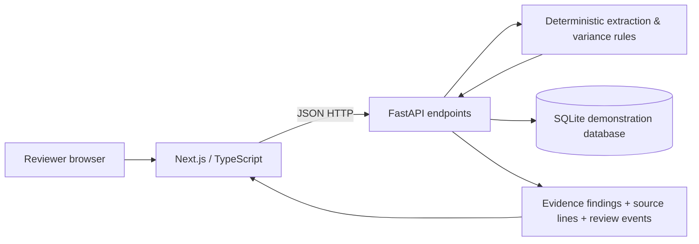
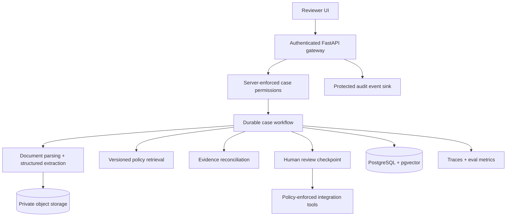

# Architecture — current and proposed

## Current v0.1

- Frontend API base URL: `NEXT_PUBLIC_API_URL` (defaults to `http://localhost:8000`).
- Backend creates demo database tables at startup; **no migration system yet**.
- Evidence fields are extracted from a constrained text format, so no OCR or natural-language reasoning should be claimed.
- Each extracted field records the first occurrence (`value`, `line`, `excerpt`). Later lines in the same document with a different value are kept under an optional `conflicts` list and feed the same variance finding. VINs are uppercased and must not contain I, O, or Q.
- Timestamps are stored and returned as UTC with an explicit `+00:00` offset.
- `GET /api/v1/claims/{id}` returns source metadata and review findings; raw source text is currently retained in the database but not returned by the public read endpoint.
- Audit events are append-only by current application convention, **not tamper-evident**.
- Claim notes are review annotations, **not settlement approvals**.

## Proposed evolution (not yet implemented)

## API contracts (v0.1)

| Method | Endpoint | Purpose |
|---|---|---|
| GET | `/health` | Dev service status |
| GET | `/api/v1/claims` | List synthetic cases |
| POST | `/api/v1/claims` | Create synthetic case |
| GET | `/api/v1/claims/{id}` | Case details, findings, audit history |
| POST | `/api/v1/claims/{id}/documents` | Add labeled text evidence; recompute findings |
| POST | `/api/v1/claims/{id}/review` | Save evidence-review note |
| POST | `/api/v1/demo/seed` | Idempotently create sample |

Use `/docs` on the running backend for typed request/response exploration.

## Data flows

**Evidence ingestion:** Browser submits text → API validates payload → deterministic regex parser extracts supported fields → original document and field metadata are stored → case is marked for review → finding computation compares values across sources.

**Review:** Browser posts a note → API validates note length → application records review event → returned case contains new activity record. No payout or coverage actions exist in the API.

## Justifying the choices

- **FastAPI:** mature typed HTTP API ecosystem and strong Python AI tooling.
- **Next.js:** supports a clear responsive reviewer interface while improving TypeScript skills.
- **SQLAlchemy:** keeps persistence access explicit and reduces coupling to the demo SQLite database.
- **SQLite initially:** reduces setup friction. Replace with PostgreSQL and migrations before concurrent multi-user or production-like tests.
- **No agent yet:** extraction, comparisons, and workflow controls are currently deterministic; LLMs would increase risk and cost without solving a demonstrated problem.
- **No RAG yet:** no meaningful policy corpus or retrieval evaluation set exists; introduce both together.

See [ADR-0001](decisions/ADR-0001-deterministic-first.md).
