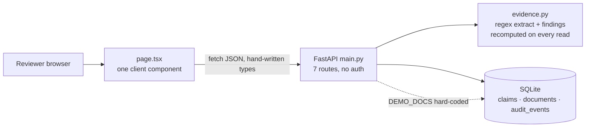
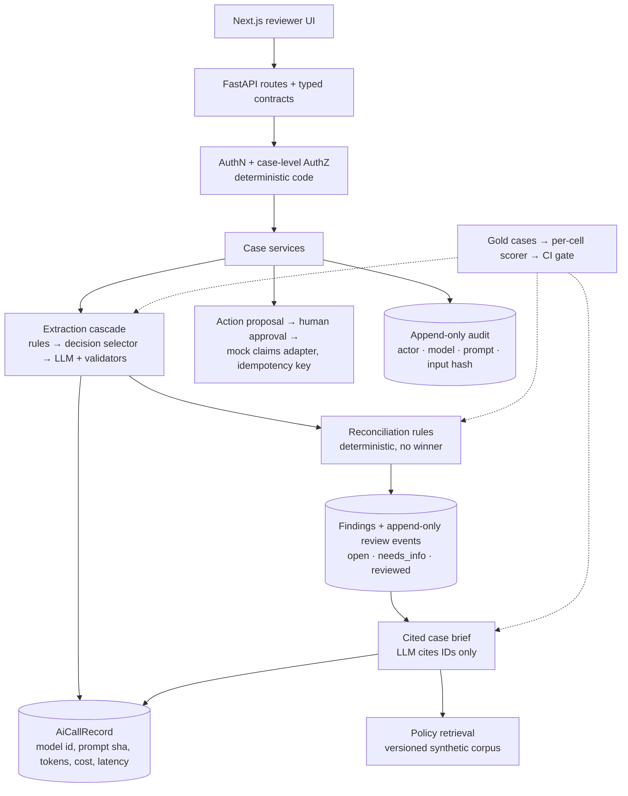
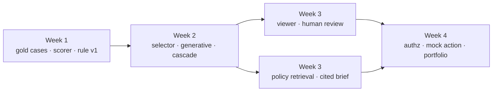

Summary: ClaimFlow v0.1 is a small, honest, working deterministic slice. The 4-week plan measures it first, then adds cheap decision models and validated LLM extraction, human review, cited retrieval, and access controls.
Goal: An interview-ready ClaimFlow in 4 weeks at 20–25 h/week, with every claim backed by a test or an eval run.
Rules: No code changes during onboarding · Observed facts cite file:line · Recommendations are labeled · No invented metrics · Hour figures are estimates, not measurements
Evidence base: All 39 tracked files read · Backend lint and tests in existing and fresh venv · Frontend clean install, typecheck, build · Live browser run of the reviewer journey · API probes · 6 audit agents, each checked by an adversarial verifier (89 findings: 57 confirmed, 32 confirmed with corrections, 0 refuted) · 3 independent critiques of this plan (hiring manager, delivery, AI evaluation)
Decided: OpenAI as provider · Public GitHub repo (created, CI green) · Commit email is the GitHub no-reply address
Decision needed: Approve the 4-week plan

## Loop
1. Audit the repository and verify builds · Claude (opus/high)
2. Review this page and answer the open questions · user
3. Settle Week 1 details with grill-me · Claude (opus/medium)
4. Build one slice, then stop for your check · Claude (sonnet/medium)
5. Review each slice in a fresh session or another tool · Codex (auto)
6. Teach-back: answer the slice's question without notes · user

## 1. Executive understanding

| Question | Answer |
|---|---|
| What ClaimFlow is | A synthetic-data-only insurance claims evidence workspace. It assembles documents, extracts facts with source locations, flags contradictions, and records human review. |
| Why it exists | Two jobs: (1) a credible enterprise AI product; (2) your structured path from RPA to AI engineering, with proof for hiring managers. |
| What it must never do | Approve, deny, or pay claims. Decide fraud. Use real or USAA data. Imply USAA affiliation. Let an LLM decide authorization. |
| What makes it different | Provenance for every finding · contradictions without a picked winner · the LLM proposes, deterministic code validates · human review by design · measured, not claimed, quality |
| What success looks like | You demo one case end to end and explain every boundary. You show an eval report with a baseline, an LLM comparison, n, and known failures. You can say which code you wrote. |

Core thesis: **an AI engineer's value is the controls and measurements around the model, not the model call.**

## 2. Repository audit

Observed state on 2026-10-15 before publishing: one commit on `main`, no git remote. Since then: repo published at github.com/yeruvamaheswar/ClaimFlow (public), pending CI and README edits committed, both CI jobs green.

| Area | What exists | Evidence |
|---|---|---|
| Git | At audit time: 1 commit, pending CI edits, no remote. Now: 2 commits, public remote, CI green. | `git log`; `gh run list` |
| Backend | FastAPI app with 7 routes (6 under `/api/v1`, plus `/health`). SQLAlchemy 2 models `Claim`, `Document`, `AuditEvent`. Tables made by `create_all`; no migrations. | `backend/app/main.py:25`, `backend/app/models.py:29-71` |
| Extraction | Regex for 3 labeled fields: incident date (ISO shape only), VIN (17 chars, no I/O/Q), estimate total (cents required). Stores value, line, excerpt; later differing values go in `conflicts`. | `backend/app/evidence.py:11-49` |
| Reconciliation | Findings computed on every read: missing doc types, date/VIN/estimate variance, no evidence. Never picks a winner. | `backend/app/evidence.py:52-103`, `backend/app/main.py:53-55` |
| Contracts | Pydantic request models with `extra="forbid"`, `SYN-` policy pattern, 50k-character text field. No response models: OpenAPI shows `schema: {}`. | `backend/app/schemas.py:11-30`; `curl /openapi.json` |
| Audit | Events for create, document added, note, demo load. No actor, no document ID, no request ID; cascade-deleted with the claim through the ORM. | `backend/app/models.py:44`, `backend/app/models.py:62-71`, `backend/app/main.py:127-131` |
| Guardrails | Refuses to start unless `CLAIMFLOW_ENV=demo`. CORS limited to one origin by default. | `backend/app/main.py:17-20`, `backend/app/main.py:35-40` |
| Frontend | Next.js 16.4.1, React 19.3.0. One 289-line client component holds all state, types, and UI. Hand-written API types. 6-line minified CSS; fonts via Google Fonts `@import`. | `frontend/app/page.tsx`, `frontend/app/globals.css:1` |
| Tests | 13 backend tests (5 API, 8 extraction/findings). No frontend tests, no ESLint, no coverage, no eval harness. | `backend/tests/` |
| Docs | PRD, architecture, roadmap, backlog, eval plan, security, research notes, ADR-0001, handoff. Strong intent; several stale facts (section 3). | `docs/` |
| Agent harness | `AGENTS.md` is canonical. `CLAUDE.md` and the Cursor rule are thin pointers. But `CLAUDE.md` links `AGENTS.md` instead of importing it (`@AGENTS.md`), so Claude Code does not load the rules automatically (observed in this session). | `CLAUDE.md:3` |

### Current architecture (observed)

## 3. Current development status

### Verification I ran

| Check | Command or method | Result |
|---|---|---|
| Backend lint | `ruff check .` (existing venv, Python 3.13.3) | pass: "All checks passed!" |
| Backend tests | `pytest -q` (existing venv) | pass: 13 passed, 1 warning (Starlette: httpx test client deprecated, use httpx2) |
| Clean backend install | fresh venv from tracked files only, `pip install '.[dev]'`, ruff, pytest | pass: 13 passed. Resolved FastAPI 0.143.2, Starlette 1.8.0, SQLAlchemy 2.1.4, Pydantic 2.14.1 |
| Clean frontend install | tracked files only, `npm ci` (Node 24.3.0) | pass: 30 packages, 0 vulnerabilities |
| Frontend typecheck | `npm run typecheck` | pass: exit 0 |
| Frontend build | `npm run build` | pass: static `/` route |
| Reviewer journey | browser: load demo → read findings → add evidence → record note | pass: 3 findings with file and line; audit trail updated; no console errors |
| Phone width | 375px viewport | pass: no horizontal overflow. Sidebar and "Synthetic data only" notice are hidden |
| CI on GitHub | push to public repo | pass: Backend checks and Frontend checks both succeeded |
| Python 3.11 / 3.12 | not run | unknown: CI targets 3.12; local runs used 3.13 |

### Status by capability

| Capability | Status | Evidence |
|---|---|---|
| Create, list, read claim | Working; list endpoint untested | `test_api.py`; no test calls `GET /api/v1/claims` |
| Add labeled text evidence | Working, tested | live run; `test_api.py:36-41` |
| Fact extraction with line + excerpt | Working for 3 rigid formats only | `evidence.py:11-20` |
| Contradiction flags without a winner | Working, tested | `test_variance_flags_multiple_values_without_picking_winner` |
| Review note + activity trail | Working, tested; the saved note is never shown in the UI | live run; `page.tsx:275` |
| Idempotent demo seed | Works for sequential calls only | see defects below |
| View original document | Missing: API never returns text | `curl /claims/{id}`: no `text` key |
| Resolve one finding | Missing: findings are not stored | `main.py:53-55` |
| File upload, PDF, OCR | Not started | PRD v0.1 out of scope |
| LLM, RAG, agents | Not started, by design | `docs/decisions/ADR-0001-deterministic-first.md` |
| Auth, case isolation | Not started | `docs/security.md` |
| Evaluation benchmark | Plan only; 0 golden cases | `docs/evaluation-plan.md:30` |

### Verified defects (reproduced by probe or browser)

| Defect | Severity (verified) | Evidence |
|---|---|---|
| Labeled but unparseable values vanish silently. `Incident Date: 09/18/2026` and `Estimate Total: $1,850` give no fact and no warning; the document still shows ✓. | medium | live run; `evidence.py:12`, `evidence.py:18`, `page.tsx:262` |
| Invalid values become facts: `$,.00` → `0.00`; `2026-02-30` and `2026-13-45` accepted. | low | probe of `extract_facts` |
| Line numbers use `str.splitlines()`, which also splits on form feed (the PDF page break) and Unicode separators. | low | probe: `"A\fIncident Date: …"` reports line 2; `evidence.py:28` |
| A user claim with policy `SYN-DEMO-AUTO-001` hijacks the demo seed (returns that claim, 0 docs). Concurrent seeds can raise an unhandled 500. | low | probe; `main.py:178` |
| An unhandled 500 has no CORS header, so the browser shows a network error instead of the status. | low | verifier probe; `main.py:35` |
| No request size limit: a 10 MB body is parsed, and the 422 echoes all 10 MB back. | low | probe |
| Duplicate document or note posts create duplicate records and audit events. | low | API probe: same body twice → 2 documents |
| Status is overwritten: a note sets `review_recorded` (shown green while flags remain); a new document resets it. | medium | `main.py:126`, `main.py:140`; live run |
| A note of 10 spaces passes validation on both sides. | low | `schemas.py:28`; verifier probe |
| Tests share one SQLite file per run, set by env var before import; files are never deleted (8 found in temp). | low | `test_api.py:6-8` |
| `npm run typecheck` rewrites the tracked `frontend/tsconfig.tsbuildinfo` and dirties git. | low | observed; I restored the file |

### Documentation that no longer matches the code

| Doc | Says | Reality |
|---|---|---|
| `docs/agent-handoff.md:7-8` | 8 tests; frontend install timed out | 13 tests; frontend installs and builds |
| `docs/roadmap.md:10,13-14` | 8 tests; frontend build open | build verified today; screenshots still open |
| `docs/PRD.md:53` (AC-02) | totals are unit tested | no unit test extracts an estimate total |
| `docs/PRD.md:57` (AC-06) | frontend build pending | verified today |
| `docs/evaluation-plan.md:32-41` | lists 8 tests | 13 exist |
| `docs/architecture.md:55` | `/docs` gives typed responses | response schemas are empty |
| `README.md:13`, `AGENTS.md:13` | every finding cites a document and line | date variance includes a synthesized "Claim intake" excerpt with no line (`evidence.py:66-69`) |
| `frontend/app/page.tsx:188` | "Read-only decision support" | the app writes claims, documents, notes |
| `QUICKSTART_MAC.md:3-5,33-36` | unzip a starter zip; ChatGPT Projects; `git init` | repo already exists |

## 4. Product and architecture gap analysis

| Vision capability | Today | Gap | Blocks |
|---|---|---|---|
| Measured quality | plan only | Large: no gold cases, scorer, or baseline | Any honest LLM claim (ADR-0001) |
| Evidence provenance | file + line + excerpt | Medium: no char offsets, method, or "unreadable" state | LLM span validation |
| AI extraction | none (deliberate) | Large | Hiring signal for GenAI roles |
| Inspect original evidence | not possible | Large | Reviewer goal 3 |
| Human review of exceptions | one note per claim | Large: no per-finding or per-fact decision | HITL differentiator |
| Workflow state | status string overwritten | Large | Controlled actions |
| Audit | rows without actor or document ID | Medium | Actions and reproducibility |
| Typed contract | requests only | Small | Frontend drift |
| Document intake | pasted text | Large: no upload, storage, PDF | Realistic demo (later) |
| AuthN/AuthZ | none | Large | Actions; any hosted demo |
| Observability, cost | none | Medium | LLM comparison |
| Reviewer UI | landing-page hero, vanity metrics, fake nav, ✓ marks, 10–11px evidence text, contrast below WCAG AA in places | Medium | Credibility in the first 10 seconds |

### Security observations (verified, prototype context)

| Area | Observation | Act when |
|---|---|---|
| Access | No identity; any caller reads and writes every case | Before actions or hosting |
| Synthetic-only rule | Enforced only by the `SYN-` policy pattern; SSN, phone, email accepted in every text field; notes stored in audit detail | Before any LLM call sees text |
| Input | No body size limit; filenames accept `../`, HTML, CRLF; labels accept bidi-override characters | Upload milestone |
| Lookalike text | VIN regex with `IGNORECASE` accepts the Kelvin sign; two VINs that look identical produce a variance | Spans slice |
| Exposure | `CLAIMFLOW_WEB_ORIGIN='*'` allowed in demo mode; no CSP or frame headers; `/docs` loads a CDN script | Before hosting |
| Strengths | React escapes all text (an `` payload did not run); no adjudication endpoints; strict request schemas; parameterized ORM queries | Keep |

## 5. Architectural recommendations

### Keep, improve, defer, remove

| Decision | Items |
|---|---|
| Keep | FastAPI + Pydantic + SQLAlchemy 2 · deterministic-first ADR · value + line + excerpt shape · "no winner" policy and wording · pure, DB-free `extract_facts` and `generate_findings` (directly scorable) · `SYN-` pattern and demo guard · `AGENTS.md` as single source · thin CI · honest README limits |
| Improve | `CLAUDE.md` imports `@AGENTS.md` · `AGENTS.md` says where decisions go (ADRs) and adds ruff to done · test fixtures with a fresh DB per test · a disposable-DB contract (schema version check) until migrations exist · facts with offsets, method, status · structured finding keys · response models · audit actor and document ID · readable CSS · component split |
| Defer | TS type generation (after shapes settle) · PostgreSQL + Alembic (first time demo data must survive a schema change) · upload and PDF via `pypdf` · pgvector (only if eval beats full-text search) · Docling (only for layout or tables) · LangGraph (likely never) · Langfuse (start with an `AiCallRecord` table) · Promptfoo (optional for red-team suites) · Presidio (synthetic data; add a redaction hook only) |
| Remove | Fake nav items · zero-padded vanity metric cards · ✓ marks on documents · marketing hero in a work tool · "Read-only" copy · tracked `tsconfig.tsbuildinfo` · zip and ChatGPT text in `QUICKSTART_MAC.md` · hard-coded test counts in docs |

### The AI roles: cheapest component that is measurably good enough

| Role | Recommendation | Measured by |
|---|---|---|
| Document Interpreter, step 1 | Code finds **candidate mentions** (every date, amount, 17-char VIN-shaped string, with offsets). A **decision model** picks which candidate is the incident date, the estimate total, the insured VIN, or "none of these". Code parses the value from the chosen span. | Per-field precision/recall vs regex; cost and latency per document |
| Document Interpreter, step 2 | Only for fields still unresolved: one generative structured-output call. Each field returns a value and an exact quote. A **span validator** checks the quote exists; a **value validator** checks the value derives from the quote. Fail → abstain. | Recall gain over step 1; validator rejection rate; unvalidated facts shown = 0 |
| Evidence Investigator + Case Summary | Merge into one **cited case brief**. Reconciliation stays deterministic. Each sentence cites fact, finding, or clause IDs. | Unsupported-sentence rate: deterministic ID checks first, then a judge calibrated on ≥30 hand-labeled sentences |
| Agent loop | Optional buffer experiment: read-only, case-scoped tools, max steps; compared with one-shot retrieval. | Quality, cost, latency on the same eval; ADR either way |

### Decision models: where they fit

Decision models (OpenAI Decisions API, TypeSafe Jev) answer a typed question with one of **your** options and a probability. They never generate text. That makes them cheaper and unable to invent a value, but they can still pick the wrong option.

| Use in ClaimFlow | Primitive | Options come from | Guardrail | Week |
|---|---|---|---|---|
| Pick the right candidate mention for each field | `choice` | candidate spans found by code, plus "none" | Value parsed by code from the chosen span; low confidence → `UNREADABLE_FIELD` for review | 2 |
| Suggest the document type | `choice` | the 5 existing `DocType` values | Suggestion only; mismatch with the user's label becomes a finding | 2 |
| Rerank retrieved policy clauses | `predicate` per clause | "this clause addresses <finding topic>" | Citation checks stay deterministic; low scores dropped, not hidden | 3 |
| Flag instructions addressed to an automated system inside a document | `predicate` | — | Shown to the reviewer only. Text is already treated as data; this never gates anything | 3 |
| Order the review queue by evidence-gap severity | `score` (rubric about evidence gaps, not claim outcome) | written rubric levels | Reviewer still sees every finding; no claim-outcome language | 3 |

**Never use a decision model for:** approve, deny, pay, fraud, coverage, authorization, or permission checks; date math, arithmetic, or value comparison; reconciliation. Those stay in code. In code and UI, call these components `selector` or `classifier`, not "decision", so no screen implies a claim decision.

| | OpenAI Decisions API | TypeSafe Jev |
|---|---|---|
| Access | Public beta (OpenAI docs, Oct 2026); `POST /v1/decisions`; Python SDK `client.decisions.create` | Early access via OpenRouter `POST /api/alpha/decisions`; model `typesafe/jev-1.13` |
| Model | `gpt-6-luna` only | Jev 1.13 (proprietary) |
| Primitives | predicate, choice, score | Noul (yes/no), choice, score |
| Input | text or base64 images | text only; 32k context on OpenRouter |
| Published price | $0.10 per 1M input tokens; no output charge | $0.042 per 1M input tokens; output free |
| Data controls | Zero Data Retention eligible | not stated; keep document text out of logs |
| Fit for you | **Primary.** You already have OpenAI credits; one key, one SDK. | **Optional comparison** in Week 4 buffer, behind the same `Selector` interface |

Prices and access status are from the vendors' pages as of October 2026. Record real cost from API usage; never quote list prices as results.

Rules for both:
- Thresholds come from the gold **dev** split; results are reported on the **holdout** split.
- Below threshold → abstain to human review, never guess.
- Log request ID, question name, probabilities, and threshold; not the document text.
- Pin the model version; record and replay responses in CI like every other model call.

### Proposed dependency checklist

| Dependency | Problem it solves | Simpler alternative | Cost | When |
|---|---|---|---|---|
| `openai` Python SDK (behind `Selector` and `Extractor` adapters) | decision models + generative extraction + case brief | none | API cost, key, nondeterminism, beta API changes | Week 2 |
| OpenRouter key (optional) | Jev comparison | skip it | second vendor, early-access API | Week 4 buffer |
| `openapi-typescript` (dev, exact pin) | TS types drift from API | hand-written types + snapshot test | low | after Week 4 |
| `pypdf` | PDF text with page numbers | pasted text | low | after Week 4 |
| PostgreSQL + Alembic | concurrency, safe migrations | SQLite + disposable-DB contract | Docker Compose; medium | after Week 4 |
| pgvector | semantic retrieval | SQLite FTS5 full-text search + decision-model rerank | low once on Postgres | only if eval shows gain |
| Playwright | UI journey regression | recorded browser script | browsers in CI | after Week 4 |
| Langfuse | traces, prompt versions | `AiCallRecord` table + run manifests | hosting; medium | after Week 4 |

### Target architecture (recommendation)

## 6. 4-week roadmap

Budget: 20–25 h/week, about 85 h planned plus a buffer. Hours are estimates. Rule: if a week overruns, its last slice moves to "Next steps"; the end date does not move.

| Week | Theme | Hours | Done when |
|---|---|---|---|
| 1 | Measured baseline | ~20 | Before/after eval report; CI gate on every push |
| 2 | Cheap-first AI extraction | ~22 | Eval report v1: regex vs decision selector vs generative vs cascade, with real cost and latency; 0 unchecked facts shown |
| 3 | Reviewer workflow + cited retrieval | ~22 | Review decisions in the audit trail; unsupported-sentence rate reported with n |
| 4 | Controls + portfolio | ~18 + buffer | Authorization tests pass; threat model, README results, 3–5 min video |

**Next steps (after Week 4, documented, not built):** PostgreSQL + Alembic · upload and PDF · durable jobs and retries · hosting in replay mode · tracing tool · agent experiment (if not done in buffer) · Jev comparison (if not done in buffer).

## 7. Week-by-week slices

Every slice's definition of done: tests or eval pass, one commit, a handoff entry (files, commands, results, actual hours), the piece you write yourself, and a 3-bullet teach-back answer.

### Slice 1: Hygiene and safe tests
- Model: sonnet/medium
- Depends on: none
- Files: `.gitignore`, `frontend/tsconfig.tsbuildinfo` (untrack), `CLAUDE.md` (`@AGENTS.md`), `AGENTS.md`, `docs/*.md` stale facts, `QUICKSTART_MAC.md` (delete), `backend/tests/conftest.py`, `backend/app/database.py` (schema-version check)
- Acceptance: each test file passes alone; dev DB unchanged after `pytest -q`; `npm run typecheck` leaves git clean; CI green.
- You write: the conftest fixture.
- [x] Week 1 · Hygiene and safe tests (2 h) · Claude (sonnet/medium) · EVAL-1..10 pass; CI green on 56ef2fd · git revert

### Slice 2: Gold corpus v0 and guideline
- Model: opus/medium
- Depends on: Slice 1
- Files: `backend/evals/GUIDELINES.md`, `backend/evals/cases/<id>/`, `backend/evals/anchor.py`, `backend/tests/test_case_files.py`, `backend/pyproject.toml`, `.gitattributes`
- Scope: 12 cases written before the parser runs on them: ≥4 forms the regex was not written for, conflicts, a distractor, an unclear date, a missing document, an injection with `must_not_extract`. Split: 8 dev, 4 holdout.
- Acceptance: lint passes (every cell labeled, offsets round-trip, hashes match); you labeled ≥3 cases.
- You write: 3 cases by hand.
- [ ] Week 1 · Gold corpus v0 (6 h) · Claude (opus/medium) · lint test passes · git revert

### Slice 3: Scorer and rule:v0 baseline
- Model: sonnet/medium
- Depends on: Slice 2
- Files: `backend/app/evidence.py` (additive `finding_key()`), `backend/evals/score.py`, `backend/evals/run.py`, `backend/evals/baselines/`, `backend/tests/test_scorer.py`, `backend/tests/test_eval_gate.py`, `.github/workflows/backend-ci.yml`
- Scope: per-cell outcomes; precision, recall, disclosure rate; k/n with Wilson intervals; per-field and per-form tables; per-cell CI gate; zero-tolerance checks for `must_not_extract` and decision words.
- Acceptance: report from a real run; gate shown failing once; scorer test equals your hand calculation.
- You write: precision and recall functions.
- [ ] Week 1 · Scorer and baseline (6 h) · Claude (sonnet/medium) · report written; gate fails on a changed cell · git revert

### Slice 4: Disclosed misses and value spans (rule:v1)
- Model: sonnet/medium
- Depends on: Slice 3
- Files: `backend/app/evidence.py`, `backend/tests/test_evidence.py`, `backend/evals/baselines/`, `frontend/app/page.tsx` (no ✓ on unreadable docs)
- Scope: offsets, method, `UNREADABLE_FIELD`, ISO date validation, amount fix; candidate-mention finder (all dates, amounts, VIN-shaped strings with offsets) for Week 2.
- Acceptance: eval diff shows silent misses → disclosed, no correct cell regresses; offsets round-trip with CRLF.
- You write: the offset function.
- [ ] Week 1 · rule:v1 with spans (6 h) · Claude (sonnet/medium) · eval diff recorded · git revert

### Slice 5: OpenAI adapter, call records, record/replay
- Model: opus/high
- Depends on: Slice 4
- Files: `backend/app/ai/client.py`, `backend/app/ai/records.py`, `backend/evals/cache/`, `backend/evals/run.py`, `.env.example`
- Scope: one adapter for Decisions and Responses calls; `AiCallRecord` (model, prompt sha, params, tokens, cost, latency, request ID); run manifest; CI replays cached responses only, a cache miss fails; key only in `.env`.
- Acceptance: CI passes with no API key; a live run writes a manifest.
- [ ] Week 2 · Adapter and replay (5 h) · Claude (opus/high) · CI green without a key · git revert

### Slice 6: Decision-model selector
- Model: sonnet/medium
- Depends on: Slice 5
- Files: `backend/app/ai/selector.py`, `backend/tests/test_selector.py`, `backend/evals/run.py`
- Scope: Decisions API `choice` over candidate mentions per field, plus "none"; document-type suggestion; thresholds set on dev cases.
- Acceptance: selector scored on dev and holdout; every selected value parses from its span; below-threshold cells abstain.
- You write: threshold selection from the dev results.
- [ ] Week 2 · Decision selector (5 h) · Claude (sonnet/medium) · holdout results in the report · git revert

### Slice 7: Generative extractor with validators, and the cascade
- Model: opus/medium
- Depends on: Slice 6
- Files: `backend/app/ai/extractor.py`, `backend/app/ai/validators.py`, `backend/app/prompts/extract_v1.md`, `backend/tests/test_validators.py`, `docs/decisions/ADR-0002-cheap-first-extraction.md`
- Scope: structured output with a quote per field; span and value validators; abstain on failure; cascade = rules → selector → generative only for unresolved fields.
- Acceptance: report v1 compares 4 systems per field with k/n, cost per case, latency; 0 unvalidated facts reach findings; injection cases change nothing.
- You write: both validators.
- [ ] Week 2 · Generative extractor and cascade (8 h) · Claude (opus/medium) · eval report v1 from a live run · git revert

### Slice 8: Corpus growth and holdout
- Model: opus/medium
- Depends on: Slice 7
- Files: `backend/evals/cases/`, `backend/evals/CHANGELOG.md`
- Scope: 12 → 24 cases with narrative documents and distractors; holdout stays frozen; no prompt edits on holdout.
- Acceptance: lint passes; report re-run on both splits.
- [ ] Week 2 · Corpus to 24 cases (4 h) · Claude (opus/medium) · report on dev and holdout · git revert

### Slice 9: Source viewer and honest UI
- Model: sonnet/medium
- Depends on: Slice 7
- Files: `backend/app/main.py`, `backend/app/schemas.py`, `frontend/components/EvidenceViewer.tsx`, `frontend/lib/api.ts`, `frontend/app/page.tsx`, `frontend/app/globals.css`, `docs/checks/browser.md`
- Scope: document endpoint; highlighted span with method badge (`rule`, `selector`, `llm`); remove hero, vanity metrics, fake nav, ✓; disclaimer visible on phones.
- Acceptance: recorded browser check; cross-claim 404 test; `` fixture renders literally.
- You write: the viewer component.
- [ ] Week 3 · Viewer and UI cleanup (6 h) · Claude (sonnet/medium) · browser check recorded · git revert

### Slice 10: Human review of proposed facts and findings
- Model: opus/medium
- Depends on: Slice 9
- Files: `backend/app/models.py`, `backend/app/services/review.py`, `backend/tests/test_review.py`, `frontend/components/FindingCard.tsx`, `docs/decisions/ADR-0003-review-events.md`
- Scope: accept / reject / needs-info per AI-proposed fact; reviewed / needs-info per finding; append-only review events keyed by `finding_key`; derived status; per-claim duplicate-document guard; copy says "reviewed — not a claim decision".
- Acceptance: transition tests (allowed and forbidden); review survives new evidence unless values change; duplicate post gives one document.
- You write: the transition table.
- [ ] Week 3 · Review workflow (8 h) · Claude (opus/medium) · transition tests pass · git revert

### Slice 11: Policy retrieval and cited case brief
- Model: opus/medium
- Depends on: Slice 7
- Files: `backend/evals/policies/`, `backend/app/retrieval.py`, `backend/app/ai/brief.py`, `backend/app/ai/citations.py`, `backend/tests/test_citations.py`
- Scope: 12 versioned synthetic policy clauses; SQLite FTS5 retrieval; decision-model predicate rerank; one generative brief that cites IDs; deterministic citation checks; instruction-in-document predicate shown to reviewer.
- Acceptance: retrieval recall@3 with k/n; unsupported-sentence rate with n; decision-word check = 0.
- You write: the citation checker.
- [ ] Week 3 · Retrieval and cited brief (8 h) · Claude (opus/medium) · metrics in report · git revert

### Slice 12: Identity, authorization, one controlled action
- Model: opus/high
- Depends on: Slice 10
- Files: `backend/app/auth.py`, `backend/app/main.py`, `backend/app/mock_claims.py`, `backend/tests/test_authz_matrix.py`, `backend/tests/test_actions.py`
- Scope: fixed demo users and roles; case-level access in code; "request more information" action: proposed → human approves → mock claims system, with idempotency key; audit has actor, model, prompt, input hash.
- Acceptance: authorization matrix (allowed and denied) passes; no action without approval; a retried action has one effect.
- You write: the authorization rules.
- [ ] Week 4 · Authz and controlled action (9 h) · Claude (opus/high) · matrix and idempotency tests pass · git revert

### Slice 13: Portfolio package
- Model: opus/medium
- Depends on: Slice 11, Slice 12
- Files: `docs/security.md` (threat model mapped to tests), `README.md` (Results block with n and date), `docs/case-study.md`, `docs/model-use.md`, `docs/interview-notes.md`
- Acceptance: every number in README links to a run; video recorded.
- [ ] Week 4 · Threat model, results, case study (5 h) · Claude (opus/medium) · links checked · git revert
- [ ] Week 4 · Record a 3–5 minute demo video · user · video file exists · none

### Slice 14 (buffer): Jev comparison or agent experiment
- Model: sonnet/medium
- Depends on: Slice 13
- Files: `backend/app/ai/selector.py`, `docs/decisions/ADR-0004-*.md`
- Scope: pick one: run the same selector questions through Jev on OpenRouter, or a bounded tool-using agent vs one-shot retrieval. Record the result in an ADR either way.
- [ ] Week 4 · Buffer experiment (4 h) · Claude (sonnet/medium) · ADR with numbers · git revert

## 8. Engineering learning roadmap

| Concept | Week | Your RPA bridge | Study task |
|---|---|---|---|
| Ground truth, precision, recall, abstention | 1 | UAT expected output; "sent to manual queue" | Compute precision/recall for 1 case by hand |
| Small-n uncertainty | 1 | Why 10 test transactions prove little | Explain why 10/10 still means about 72–100% |
| Decision models vs generative models | 2 | Document Understanding classifier vs extractor | Explain when a finite answer set beats generation |
| Thresholds and calibration | 2 | Confidence threshold before Validation Station | Pick a threshold from dev results |
| Validators and abstention | 2 | Validation Station rules | Write the span and value validators |
| Retrieval and citations | 3 | Looking up the right SOP section | Explain recall@3 on one query |
| State machines | 3 | Orchestrator queue states | Write the review transition table |
| Authorization and idempotency | 4 | Role-based Orchestrator access; no double-processing after retry | Write the authz matrix |

## 9. Portfolio and hiring impact

| Output | Interview line |
|---|---|
| Gold corpus + per-cell gate | "I defined correct first, and CI shows exactly which case moved." |
| rule:v0 → rule:v1 | "My first change was measured: silent misses became disclosed, no regressions." |
| Cheap-first cascade | "Rules first, a decision model picks among real text candidates, generation only for the rest. Here is the cost per extra correct field." |
| Validators | "The model can't put a value on screen that isn't in the document." |
| Review workflow | "AI proposes; a person accepts or rejects each fact; the audit records model and prompt version." |
| Cited brief | "Every sentence cites IDs; here is the unsupported-sentence rate and its n." |
| Authz + controlled action | "The model never decides permissions; the matrix tests prove it." |

| Interviewer question | Answerable after |
|---|---|
| How was ground truth built, and how sure are the numbers? | Week 1 |
| Why a decision model here and a generative model there? | Week 2 |
| What stops a made-up value? | Week 2 |
| Where did each system win, and at what cost? | Week 2 |
| Show what an injection document does. | Week 2 |
| How does a reviewer overrule the AI? | Week 3 |
| Reproduce why this finding appeared. | Week 4 |
| Why not an agent? | Week 4 (ADR) |
| Which code did you write? | Every slice |

## 10. Key risks and trade-offs

| Risk | Effect | Mitigation |
|---|---|---|
| 85 h of work in 4 weeks | Burnout or slip | Cut rule per week; buffer slice is the first to go |
| Decisions API is in public beta | Endpoint or behavior changes | Adapter + pinned model + record/replay; Responses API structured output as fallback |
| Decision model picks the wrong candidate confidently | Wrong fact | Value parsed from the span; low confidence abstains; reviewer accepts or rejects |
| "Decision" wording | Reads like claim adjudication | Call it `selector`/`classifier`; decision-word check in CI |
| Circular gold | Inflated results | Gold-first rule; per-form breakdown; holdout |
| Small n | Misleading percentages | k/n with Wilson intervals; README says "regression fixture, not a benchmark" |
| Prompt overfitting | Rising dev scores only | Frozen holdout; report holdout separately |
| Public repo from day one | Mistakes visible; secrets risk | Key only in `.env` (ignored); secret scan before each push; commit email is the no-reply address |
| Understanding gap | Weak interviews | You write one piece per slice; teach-back per slice |

## 11. Recommended next action

1. Approve this 4-week plan, or name cuts.
2. Before Week 2: confirm your OpenAI key can call `POST /v1/decisions` (public beta) and set a spending limit.
3. Next session: grill-me on Week 1, then build Slice 1 and stop for your check.

## Requirements
Slice 1 (Hygiene and safe tests). Settled with grill-me on 2026-10-15.

| ID | Requirement | Source |
|---|---|---|
| REQ-1 | Each backend test runs against its own fresh database, never the dev DB, whether run alone or in the full suite | agent |
| REQ-2 | The app refuses to start on a SQLite DB whose schema version does not match the code, and the error names the reset command | agent |
| REQ-3 | Running `npm run typecheck` or `npm run build` leaves `git status` clean | agent |
| REQ-4 | Claude Code loads `AGENTS.md` automatically through `CLAUDE.md` | agent |
| REQ-5 | Docs state no stale facts found by the audit, and no hard-coded test counts | agent |
| REQ-6 | `QUICKSTART_MAC.md` is removed; README is the only setup guide | user |
| REQ-7 | Each slice is pushed to the public repo once local checks and a secret scan pass | user |
| NOT-1 | No secret, key, or `.env` file is ever committed | agent |
| NOT-2 | No behavior change to API endpoints or extraction in Slice 1 | agent |

## Decisions
| ID | Decision | By |
|---|---|---|
| DEC-1 | OpenAI is the LLM provider; Decisions API primary, Jev optional | user |
| DEC-2 | Repo is public from the start; commits use the GitHub no-reply email | user |
| DEC-3 | Push each slice automatically after local checks and a secret scan | user |
| DEC-4 | Delete `QUICKSTART_MAC.md` | user |
| DEC-5 | Test isolation: a pytest fixture gives each test a new SQLite file and overrides the `get_db` dependency | agent |
| DEC-6 | Schema version lives in SQLite `PRAGMA user_version`; current schema is version 1; a version-0 DB with the expected tables is stamped as 1 once; any other mismatch refuses to start | agent |
| DEC-7 | Untrack and ignore `frontend/tsconfig.tsbuildinfo` and `frontend/next-env.d.ts`; `npm run typecheck` runs `next typegen` first so CI can type-check without a build (changed during Slice 1: build rewrote `next-env.d.ts`) | agent |

## Evals
| ID | REQ | Check | Method | Result |
|---|---|---|---|---|
| EVAL-1 | REQ-1 | `pytest tests/test_api.py` and `pytest tests/test_evidence.py` each pass alone; full suite passes | unit | pass 2026-10-15: test_api 5, test_evidence 8, test_schema_version 2 alone; full suite 15 passed |
| EVAL-2 | REQ-1 | `backend/claimflow.db` sha256 is identical before and after `pytest -q` | integration | pass 2026-10-15: sha256 77dc773a… before and after |
| EVAL-3 | REQ-2 | A test DB with `user_version=99` makes startup raise an error that mentions deleting the DB file | unit | pass 2026-10-15: test_mismatched_version_raises_with_delete_hint |
| EVAL-4 | REQ-2 | A version-0 DB with the expected tables starts and is stamped 1 | unit | pass 2026-10-15: test_unstamped_db_with_tables_is_stamped |
| EVAL-5 | REQ-3 | After `npm run typecheck` and `npm run build`, `git status --porcelain` is empty | integration | pass 2026-10-15: git status clean after typecheck, build, and next dev |
| EVAL-6 | REQ-4 | `CLAUDE.md` contains `@AGENTS.md` | verifier diff | pass 2026-10-15: CLAUDE.md:3 |
| EVAL-7 | REQ-5 | grep finds no "8 passing", "8 tests", "timed out", or "verification pending" in docs | verifier diff | pass 2026-10-15: 0 grep hits |
| EVAL-8 | REQ-6 | `QUICKSTART_MAC.md` absent; README project map has no reference to it | verifier diff | pass 2026-10-15: file absent; 0 README refs |
| EVAL-9 | REQ-7, NOT-1 | Secret scan over the diff finds nothing; push succeeds; both CI jobs green | integration | pass 2026-10-15: scan clean; commit 56ef2fd; Backend and Frontend checks green |
| EVAL-10 | NOT-2 | Existing 13 tests pass unchanged in assertions | unit | pass 2026-10-15: assertions identical apart from indentation |

## Infrastructure
| Resource | Defined in | Applied by | Secrets |
|---|---|---|---|
| GitHub repo (public) | manual (`gh repo create`, 2026-10-15) | Claude | none |
| Backend CI | `.github/workflows/backend-ci.yml` | GitHub Actions | none |
| Frontend CI | `.github/workflows/frontend-ci.yml` | GitHub Actions | none |

## Observability
| Signal | Seen in | Eval |
|---|---|---|
| CI pass or fail per push | GitHub Actions | EVAL-9 |
| Startup refusal on schema mismatch | process stderr | EVAL-3 |

## Work
### Always loaded
- `AGENTS.md`
- `README.md`
- `plans/claimflow-onboarding.md`
### On demand
- `docs/evaluation-plan.md` for Slices 2–3
- `docs/security.md` for Slices 9–12
- OpenAI Decisions guide for Slice 6
### Steps
- [x] Read all tracked files and docs · Claude (opus/high) · 39 tracked files read · none
- [x] Verify backend lint and tests · Claude (opus/high) · ruff pass; 13 passed in existing and fresh venv · none
- [x] Verify frontend clean install, typecheck, build · Claude (opus/high) · npm ci 0 vulnerabilities; typecheck exit 0; build pass · none
- [x] Walk the reviewer journey in a browser · Claude (opus/high) · demo, findings, add evidence, note, audit worked; gaps in section 3 · none
- [x] Run 6-dimension audit with adversarial verification · Claude (opus/high) · 89 findings; 57 confirmed, 32 corrected, 0 refuted · none
- [x] Critique the plan from 3 lenses and revise · Claude (opus/high) · eval before extraction change; LLM moved earlier · none
- [x] Re-author commit to GitHub no-reply email · Claude (opus/high) · commit 653b900 · none
- [x] Commit pending CI and README edits · Claude (opus/high) · commit 0d6ac8c · git revert
- [x] Create public GitHub repo and push · Claude (opus/high) · github.com/yeruvamaheswar/ClaimFlow; Backend and Frontend checks green · delete repo
- [x] Approve the 4-week plan · user · approved 2026-10-15 · none
- [ ] Confirm OpenAI key can call the Decisions API and set a spend limit · user · one test call succeeds · none
### Open
- Does your OpenAI key have Decisions API access (public beta): unknown
- Which generative OpenAI model to pin for Slice 7: unknown (choose in Week 2 from current docs and pricing)
- Hosting after Week 4: unknown
- Does CI pass on Python 3.11: unknown
